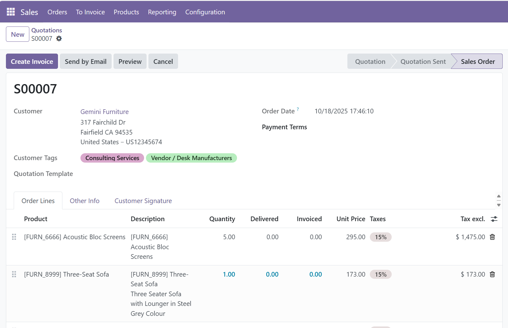

===========================
Customer Tags in Sale Order
===========================

.. 
   !!!!!!!!!!!!!!!!!!!!!!!!!!!!!!!!!!!!!!!!!!!!!!!!!!!!
   !! This file is generated by oca-gen-addon-readme !!
   !! changes will be overwritten.                   !!
   !!!!!!!!!!!!!!!!!!!!!!!!!!!!!!!!!!!!!!!!!!!!!!!!!!!!
   !! source digest: sha256:9b01cd85d8fa043c319bdbd49f61780dd3c8e6169024156aa81e98221a34a857
   !!!!!!!!!!!!!!!!!!!!!!!!!!!!!!!!!!!!!!!!!!!!!!!!!!!!

.. |badge1| image:: https://img.shields.io/badge/maturity-Beta-yellow.png
    :target: https://odoo-community.org/page/development-status
    :alt: Beta
.. |badge2| image:: https://img.shields.io/badge/license-AGPL--3-blue.png
    :target: http://www.gnu.org/licenses/agpl-3.0-standalone.html
    :alt: License: AGPL-3
.. |badge3| image:: https://img.shields.io/badge/github-HoloborodkoBohdan%2Fodoo--addons-lightgray.png?logo=github
    :target: https://github.com/HoloborodkoBohdan/odoo-addons/tree/16.0/customer_tags_sale_order
    :alt: HoloborodkoBohdan/odoo-addons

|badge1| |badge2| |badge3|

Shows the customer's tags on the sales order form, right below the customer.
The tags are read-only there and the field is hidden when the customer has no tags.

Also adds a **Has tags** filter to the contacts search view.

**Table of contents**

.. contents::
   :local:

Usage
=====

#. Set tags on a customer: open the contact and fill in the **Tags** field.
#. Open or create a sales order for that customer: its tags are shown under
   the **Customer** field.
#. To list the customers that have tags, use the **Has tags** filter in Contacts.

Changelog
=========

16.0.1.0.1
~~~~~~~~~~

* Fix the Ukrainian translation: the ``.po`` file pointed to the old module
  name, so it was never applied.
* Show the tags field without the stored helper field ``has_partner_tags``.
* Depend on ``sale`` only, instead of ``contacts`` and ``sale_management``.
* Add tests.

16.0.1.0.0
~~~~~~~~~~

* Renamed from ``partner_tags_sale_order``, published on the Odoo Apps Store
  for 12.0 to 15.0.

Bug Tracker
===========

Bugs are tracked on `GitHub Issues <https://github.com/HoloborodkoBohdan/odoo-addons/issues>`_.
In case of trouble, please check there if your issue has already been reported.
If you spotted it first, help us to smash it by providing a detailed and welcomed
`feedback <https://github.com/HoloborodkoBohdan/odoo-addons/issues/new?body=module:%20customer_tags_sale_order%0Aversion:%2016.0%0A%0A**Steps%20to%20reproduce**%0A-%20...%0A%0A**Current%20behavior**%0A%0A**Expected%20behavior**>`_.

Do not contact contributors directly about support or help with technical issues.

Credits
=======

Authors
~~~~~~~

* Bohdan Holoborodko

Contributors
~~~~~~~~~~~~

* Bohdan Holoborodko <odoo@holoborodko.com.ua>

Maintainers
~~~~~~~~~~~

This module is part of the `HoloborodkoBohdan/odoo-addons <https://github.com/HoloborodkoBohdan/odoo-addons/tree/16.0/customer_tags_sale_order>`_ project on GitHub.

You are welcome to contribute.
