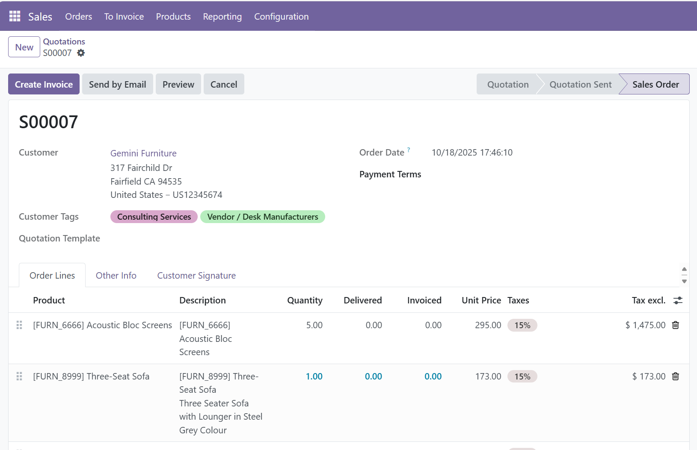

Shows the customer's tags on the sales order form, right below the customer.
The tags are read-only there and the field is hidden when the customer has no tags.

Also adds a **Has tags** filter to the contacts search view.

