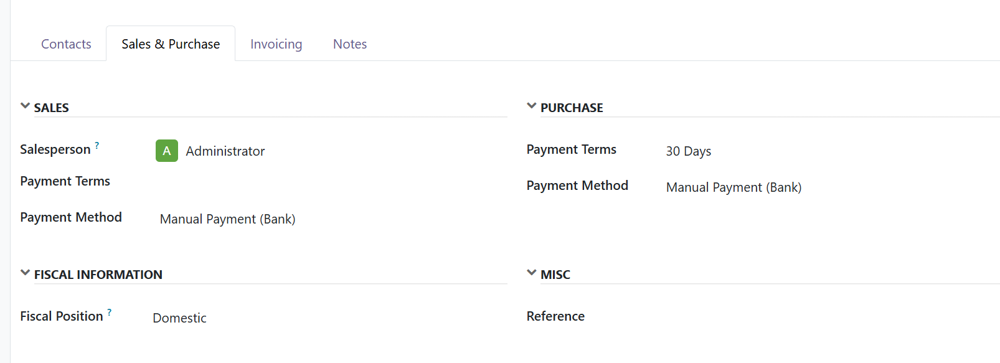
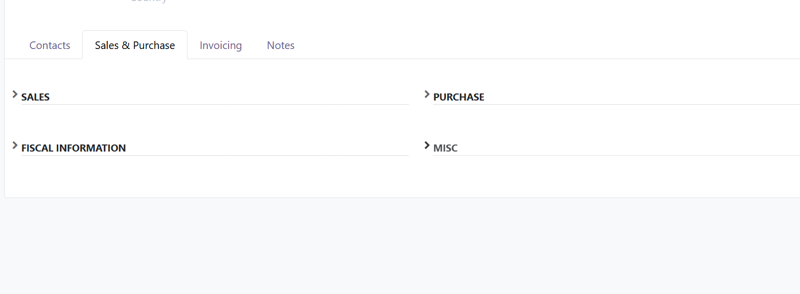

=================
Form Group Toggle
=================

.. 
   !!!!!!!!!!!!!!!!!!!!!!!!!!!!!!!!!!!!!!!!!!!!!!!!!!!!
   !! This file is generated by oca-gen-addon-readme !!
   !! changes will be overwritten.                   !!
   !!!!!!!!!!!!!!!!!!!!!!!!!!!!!!!!!!!!!!!!!!!!!!!!!!!!
   !! source digest: sha256:7c14dc1959917fb8764bd865eac88491eb53cae496bdc0b8caed0ceeb8cf7895
   !!!!!!!!!!!!!!!!!!!!!!!!!!!!!!!!!!!!!!!!!!!!!!!!!!!!

.. |badge1| image:: https://img.shields.io/badge/maturity-Beta-yellow.png
    :target: https://odoo-community.org/page/development-status
    :alt: Beta
.. |badge2| image:: https://img.shields.io/badge/license-AGPL--3-blue.png
    :target: http://www.gnu.org/licenses/agpl-3.0-standalone.html
    :alt: License: AGPL-3
.. |badge3| image:: https://img.shields.io/badge/github-HoloborodkoBohdan%2Fodoo--addons-lightgray.png?logo=github
    :target: https://github.com/HoloborodkoBohdan/odoo-addons/tree/19.0/form_group_toggle
    :alt: HoloborodkoBohdan/odoo-addons

|badge1| |badge2| |badge3|

This module adds collapse and expand functionality to groups in Odoo form views.

Features:

* Click anywhere on group titles to collapse/expand content
* Smooth animations and hover effects
* Works on all groups with labels in form views
* Compatible with Odoo 19

**Table of contents**

.. contents::
   :local:

Usage
=====

To use this module:

1. Install the module
2. Open any form view with groups that have labels
3. Click on the group title or chevron icon to toggle

Any group with a ``string`` attribute will automatically have collapse/expand functionality.

Screenshots
~~~~~~~~~~~

Groups in opened state:

Groups in closed state:

Example
~~~~~~~

.. code-block:: xml

    <group string="Contact Information">
        <field name="email"/>
        <field name="phone"/>
    </group>

The "Contact Information" group will display a chevron icon next to the title.
Click anywhere on the title area to collapse or expand the group content.

Bug Tracker
===========

Bugs are tracked on `GitHub Issues <https://github.com/HoloborodkoBohdan/odoo-addons/issues>`_.
In case of trouble, please check there if your issue has already been reported.
If you spotted it first, help us to smash it by providing a detailed and welcomed
`feedback <https://github.com/HoloborodkoBohdan/odoo-addons/issues/new?body=module:%20form_group_toggle%0Aversion:%2019.0%0A%0A**Steps%20to%20reproduce**%0A-%20...%0A%0A**Current%20behavior**%0A%0A**Expected%20behavior**>`_.

Do not contact contributors directly about support or help with technical issues.

Credits
=======

Authors
~~~~~~~

* Bohdan Holoborodko

Contributors
~~~~~~~~~~~~

* Bohdan Holoborodko <odoo@holoborodko.com.ua>

Maintainers
~~~~~~~~~~~

This module is part of the `HoloborodkoBohdan/odoo-addons <https://github.com/HoloborodkoBohdan/odoo-addons/tree/19.0/form_group_toggle>`_ project on GitHub.

You are welcome to contribute.
